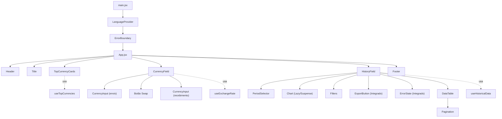

# Hermes — Currency Exchange App

**Documentação técnica completa e revisão do projeto**

> Última atualização: 03/11/2026  
> Estado atual: aplicação funcional, simplificada, `npm run lint` sem erros e `npm run build` passando com bundle otimizado.

---

## Sumário

1. [Visão geral](#1-visão-geral)
2. [Stack e dependências](#2-stack-e-dependências)
3. [Como executar](#3-como-executar)
4. [Estrutura de pastas](#4-estrutura-de-pastas)
5. [Arquitetura](#5-arquitetura)
6. [Fluxo de dados](#6-fluxo-de-dados)
7. [Funcionalidades](#7-funcionalidades)
8. [Catálogo de componentes](#8-catálogo-de-componentes)
9. [Hooks, serviços e utilitários](#9-hooks-serviços-e-utilitários)
10. [API Frankfurter](#10-api-frankfurter)
11. [Design system](#11-design-system)
12. [Regras de negócio e cálculos](#12-regras-de-negócio-e-cálculos)
13. [Revisão técnica](#13-revisão-técnica)
14. [Verificação e testes](#14-verificação-e-testes)
15. [Roadmap sugerido](#15-roadmap-sugerido)
16. [Mapa de arquivos](#16-mapa-de-arquivos)
17. [Glossário](#17-glossário)

---

## 1. Visão geral

O **Hermes** é uma SPA (Single Page Application) de conversão e acompanhamento de câmbio. A aplicação consome dados públicos da **Frankfurter API**, que usa as taxas de referência diárias do **Banco Central Europeu (ECB)**.

### Principais recursos atuais

| Recurso | Onde está |
| :--- | :--- |
| Conversão entre moedas com valor digitado e resultado automático | `CurrencyField` + `CurrencyInput` |
| Botão de inversão (swap) entre moeda de origem e destino | `CurrencyField` |
| Cards das 5 moedas mais negociadas com conversão 1:1, variação e bandeiras reais | `TopCurrencyCards` |
| Seletor de período histórico (7D a 10A) | `PeriodSelector` |
| Gráfico de área interativo sob demanda com cursor fluido e tooltip completo | `Chart` (Recharts, lazy) |
| Painel de máxima, mínima e variação do período em passagem única | `HistoryField` |
| Filtros por data e faixa de cotação | `Filters` |
| Tabela ordenável com variação diária calculada em ordem cronológica | `DataTable` |
| Paginação da tabela (10 linhas por página) | `DataTable` + `Pagination` |
| Exportação CSV nativa dos dados filtrados com UTF-8 BOM e delimitador `;` | `HistoryField` + `utils/csv.js` |
| Internacionalização completa PT / EN / ES | `LanguageProvider` + `useLanguage` |
| Layout responsivo (mobile, tablet, desktop) | Tailwind CSS v4 |
| Tratamento de erro com retry no histórico e na lista de moedas | `HistoryField`, `App` |
| Error Boundary para capturar falhas inesperadas de renderização | `ErrorBoundary` |
| Cancelamento automático de requisições obsoletas | Hooks com `AbortController` |
| Timeout nativo de 10s, retry automático e cache em memória de 5 min | `services/api.js` |

### Público-alvo

Viajantes, profissionais remotos/freelancers, investidores, estudantes e consumidores de e-commerce internacional.

### O que o projeto **não** faz

- Não executa ordens financeiras nem integra com bancos/gateways.
- Não possui login, contas ou autenticação.
- Não envia alertas por e-mail/push.
- Não suporta criptomoedas.
- Não aplica spread comercial; usa a taxa de referência do ECB.
- Não faz paginação no servidor: toda a paginação é client-side.
- Não possui suíte de testes automatizados ou pipeline de CI configurados.

---

## 2. Stack e dependências

| Tecnologia | Versão | Uso no projeto |
| :--- | :--- | :--- |
| **React** | `^19.3.1` | Componentes, estado e hooks |
| **React DOM** | `^19.3.1` | Renderização no navegador |
| **Vite** | `^8.3.0` | Dev server, build e HMR |
| **@vitejs/plugin-react** | `^6.1.1` | Plugin React para o Vite |
| **Tailwind CSS** | `^4.3.3` | Estilização utilitária |
| **@tailwindcss/vite** | `^4.3.3` | Integração do Tailwind v4 no Vite |
| **Recharts** | `^3.10.1` | Gráfico de área do histórico (carregado sob demanda) |
| **date-fns** | `^4.4.0` | Formatação/localização de datas no gráfico |
| **lucide-react** | `^1.59.0` | Ícones (swap, exportação, setas, paginação) |
| **ESLint** | `^10.10.0` | Análise estática |
| **eslint-plugin-react-hooks** | `^7.1.1` | Regras de hooks |
| **eslint-plugin-react-refresh** | `^0.5.6` | Regra de Fast Refresh |
| **globals** | `^17.12.0` | Globais do ambiente no ESLint |

> A biblioteca `papaparse` foi removida em favor de um gerador nativo leve de CSV, economizando cerca de 20 kB no bundle inicial.

### Scripts disponíveis

```bash
npm run dev      # inicia o Vite em modo desenvolvimento
npm run build    # gera a versão de produção em dist/
npm run preview  # serve o build de produção
npm run lint     # executa o ESLint
```

---

## 3. Como executar

### Pré-requisitos

- Node.js 20+ (recomendado 22+)
- npm

### Passos

```bash
# 1. Entre na pasta correta
cd currency-exchange-app

# 2. Instale as dependências
npm install

# 3. Inicie o servidor de desenvolvimento
npm run dev

# 4. Acesse a URL exibida no terminal (geralmente http://localhost:5173)
```

Para gerar e visualizar o build de produção:

```bash
npm run build
npm run preview
```

### Variáveis de ambiente

A URL da API pode ser sobrescrita por uma variável do Vite:

```bash
# .env
VITE_API_BASE_URL=https://api.frankfurter.dev/v1
```

---

## 4. Estrutura de pastas

```text
p1-currency-exchange-app/
├── .gitignore
└── currency-exchange-app/
    ├── index.html
    ├── package.json
    ├── package-lock.json
    ├── vite.config.js
    ├── eslint.config.js
    ├── public/
    │   ├── avatar.jpg            # usado no Header/Footer
    │   └── favicon.svg
    ├── docs/
    │   ├── AI_USAGE.md           # registro detalhado de uso de IA
    │   ├── API_TESTS.md          # testes de integração da API Frankfurter
    │   ├── COMPONENTS.md         # catálogo técnico de componentes
    │   ├── FIGMA.md              # mapeamento de design system e tokens
    │   ├── FUNCTION_TESTS.md     # testes unitários e casos de borda
    │   ├── REQUIREMENTS.md       # requisitos funcionais e regras de negócio
    │   └── Hermes_Currency_API.postman_collection.json
    └── src/
        ├── main.jsx              # entrada, provider e Error Boundary
        ├── App.jsx               # raiz, orquestração e estado das moedas
        ├── index.css             # @import "tailwindcss"
        ├── components/
        │   ├── Header.jsx        # logo, avatar e seletor de idioma
        │   ├── Title.jsx         # hero com tagline, título e subtítulo
        │   ├── TopCurrencyCards.jsx # cards das 5 moedas com badges visuais
        │   ├── CurrencyField.jsx # conversor, sanitização de entrada e swap
        │   ├── CurrencyInput.jsx # input de valor e select de moedas
        │   ├── HistoryField.jsx  # orquestrador histórico, filtros, exportação e erro
        │   ├── PeriodSelector.jsx# botões de período (7D a 10A)
        │   ├── Chart.jsx         # gráfico Recharts com chave única e tooltip real
        │   ├── Filters.jsx       # filtros de data e cotação
        │   ├── DataTable.jsx     # tabela ordenável com variação diária
        │   ├── Pagination.jsx    # paginação da tabela (10 linhas/pág)
        │   ├── ErrorBoundary.jsx # Error Boundary com fallback integrado
        │   └── Footer.jsx        # rodapé institucional
        ├── context/
        │   ├── languageContext.js # createContext isolado
        │   ├── translations.js    # textos completos PT/EN/ES
        │   ├── LanguageProvider.jsx
        │   └── useLanguage.js
        ├── hooks/
        │   ├── useExchangeRate.js
        │   ├── useHistoricalData.js
        │   └── useTopCurrencies.js
        ├── services/
        │   └── api.js            # cliente HTTP com AbortSignal nativo e cache
        └── utils/
            ├── formatters.js     # toISODate e formatRate unificados
            └── csv.js            # exportador CSV nativo com UTF-8 BOM
```

---

## 5. Arquitetura

A aplicação segue uma arquitetura limpa em React 19, com separação bem definida entre apresentação, composição de estado, infraestrutura de rede e utilitários puros.

### Árvore de componentes



### Onde cada estado vive

| Estado | Dono | Tipo | Descrição |
| :--- | :--- | :--- | :--- |
| `currencies` | `App` | `object` | Lista de códigos e nomes `{ USD: "United States Dollar", ... }` |
| `currenciesError` / `currenciesRetry` | `App` | `string \| null` / `number` | Erro e contador para retry da lista de moedas |
| `from` | `App` | `string` | Moeda de origem selecionada (padrão `"USD"`) |
| `to` | `App` | `string` | Moeda de destino selecionada (padrão `"BRL"`) |
| `language` | `LanguageProvider` | `"PT" \| "EN" \| "ES"` | Idioma ativo da aplicação |
| `amount` | `CurrencyField` | `string` | Valor de envio digitado (padrão `"1000"`) |
| `period` | `HistoryField` | `string` | Período histórico ativo (padrão `"30D"`) |
| `filters` | `HistoryField` | `object` | `{ startDate, endDate, minRate, maxRate }` |
| `sortField` / `sortDir` | `HistoryField` | `string` / `string` | `"date" \| "rate"` e `"asc" \| "desc"` |
| `page` / `prevData` | `DataTable` | `number` / `array` | Página atual e rastreamento de reset |

---

## 6. Fluxo de dados

### 6.1. Inicialização

1. `main.jsx` monta `<LanguageProvider><ErrorBoundary><App /></ErrorBoundary></LanguageProvider>`.
2. `App` busca a lista de moedas em `/currencies` e popula `currencies`.
3. Em caso de falha de conexão, `App` exibe um banner de alerta com botão funcional de retry.
4. `App` define `from = "USD"` e `to = "BRL"`.
5. Em paralelo, os três hooks de dados entram em ação:
   - `useTopCurrencies` busca as taxas das 5 principais moedas.
   - `useExchangeRate` busca a cotação comercial atual entre `from` e `to`.
   - `useHistoricalData` busca a série histórica dos últimos 30 dias.

### 6.2. Conversor

```text
Usuário digita amount
        ↓
CurrencyField.handleAmountChange
  - converte vírgula para ponto
  - remove caracteres inválidos
  - permite apenas um separador decimal
        ↓
Cálculo Síncrono Imediato: result = amount * rate (sem chamada de rede)
        ↓
CurrencyInput de destino (readOnly) exibe valor formatado via Intl.NumberFormat
```

### 6.3. Cards de moedas principais

```text
from (App)
   ↓
useTopCurrencies(from)
   ↓
GET /{início}..{fim}?from={from}&to=USD,EUR,GBP,JPY,CNY (menos a própria base)
   ↓
Compara último dia útil com penúltimo dia útil
   ↓
rate = 1 from = X moeda
variação = ((atual - anterior) / anterior) * 100
   ↓
Badges visuais de alta definição via FlagCDN (compatíveis com Windows, Mac e mobile)
```

### 6.4. Histórico e Processamento

```text
from, to, period
   ↓
useHistoricalData → GET /{start}..{end}?from&to
   ↓
HistoryField (em passagem única otimizada via useMemo):
   1. Aplica filtros de data e faixa de cotação  → chronologicalData
   2. Calcula variação diária no dia anterior    → dataWithVariation
   3. Computa máxima, mínima e variação total    → stats
   4. Ordena apenas a cópia visual para tabela   → tableData
   ↓
Chart (sob demanda) / Stats de Mercado / DataTable / Exportação CSV
```

---

## 7. Funcionalidades

### 7.1. Cards das 5 moedas principais — `TopCurrencyCards`

- Lista fixa: **USD, EUR, GBP, JPY, CNY** (as 5 moedas mais transacionadas do mundo).
- A moeda base é a **moeda de envio (`from`)** escolhida no conversor.
- Cada card exibe `1 {from} = X {moeda do card}`.
- O card correspondente à própria moeda base exibe `1,0000` e o selo **“Moeda base”**.
- **Badges de Bandeiras Reais:** Substituem os emojis de texto comuns (que o Windows não renderiza), utilizando imagens de alta definição com suporte a telas retina (`2x`) via FlagCDN.
- Variação calculada entre os **dois últimos dias úteis disponíveis** da série recente.
- Cores dinâmicas:
  - **Alta/Estável** (`variação >= 0`): fundo verde claro (`bg-emerald-100`).
  - **Baixa** (`variação < 0`): fundo vermelho claro (`bg-red-100`).
- No mobile, o 5º card ocupa 2 colunas para manter o layout balanceado sem colunas órfãs.

### 7.2. Conversor — `CurrencyField` + `CurrencyInput`

- Valor inicial: `1000`.
- Sanitização de teclado: aceita números, vírgula e ponto; converte vírgula para ponto e bloqueia múltiplos separadores.
- Campo de recebimento somente leitura com 2 casas decimais no padrão do idioma ativo (`pt-BR`, `en-US`, `es-ES`).
- Botão central de **Swap** com ícone `ArrowRightLeft` rotacionando 90° em smartphones.
- Rodapé informativo com a taxa comercial `1 {from} = X.XXXX {to}` e data oficial de referência.

### 7.3. Histórico — `HistoryField`

- Períodos disponíveis: `7D`, `15D`, `30D`, `3M`, `6M`, `1A`, `5A`, `10A`.
- Filtros por data inicial/final e limites mínimo/máximo de cotação com botão de limpeza.
- Painel **MERCADO** com Cotação Máxima, Cotação Mínima e Variação percentual do período.
- **Resiliência e Retry:** Se a rede falhar, exibe o componente integrado `ErrorState` com botão funcional para tentar novamente (`refetch()`).

### 7.4. Gráfico Interativo de Alta Precisão — `Chart`

- Implementado com **Recharts** e carregado sob demanda via `React.lazy` + `<Suspense>`.
- **Chave Única no Eixo X (`dataKey="date"`):** Cada ponto do gráfico utiliza a data ISO (`YYYY-MM-DD`), garantindo que o cursor do mouse e a bolinha (`activeDot`) deslizem sem travar ou congelar.
- **Tooltip Completo:** Card flutuante que exibe a data real completa (dia, mês e ano de 4 dígitos, ex: `15 set. 2026`) e a cotação com 4 casas decimais.
- **Formatação Contextual dos Ticks:**
  - `7D`, `15D`, `30D`, `3M`: exibe `"dd MMM"` (dia e mês legíveis).
  - `6M`, `1A`: exibe `"MMM yyyy"` (mês e ano de 4 dígitos sem abreviações dúbias).
  - `5A`, `10A`: exibe `"yyyy"` (ano completo).

### 7.5. Tabela e Paginação — `DataTable` + `Pagination`

- Colunas: Data, Origem, Destino, Cotação e Variação.
- Cabeçalhos de Data e Cotação são botões acessíveis para ordenação com `aria-sort`.
- **Paginação client-side** com 10 linhas por página (`Pagination`).
- Retorno automático para a página 1 ao alterar filtros ou ordenação.
- Variação diária calculada em ordem cronológica ascendente, mantendo-se correta independentemente da ordenação visual da tabela.

### 7.6. Exportação CSV Nativa — `utils/csv.js`

- Gerador nativo leve em JavaScript puro, sem bibliotecas externas.
- Delimitador padrão `;` e quebra de linha `\r\n`.
- Prefixo **BOM UTF-8 (`\uFEFF`)** para garantir abertura perfeita com acentuação correta no Microsoft Excel.
- Exporta todos os dados filtrados, independentemente da página em visualização.
- Nome do arquivo padronizado: `{from}_{to}_historico_{YYYY-MM-DD}.csv`.

### 7.7. Internacionalização — `LanguageProvider`

- Suporte completo a **Português (`PT`)**, **Inglês (`EN`)** e **Espanhol (`ES`)**.
- Formatação numérica via `Intl.NumberFormat` e datas do gráfico via `date-fns` com locales `ptBR`, `enUS` e `es`.

### 7.8. Resiliência da Camada de Rede — `services/api.js`

- **Timeout nativo de 10s:** `AbortSignal.timeout(10_000)` combinado com o sinal do componente via `AbortSignal.any`.
- **Retry automático:** Até 2 tentativas em caso de erro 5xx, timeout ou falha de rede (`TypeError`).
- **Cache em memória:** TTL de 5 minutos por URL, evitando requisições repetidas.
- **Cancelamento:** `AbortController` cancela requisições obsoletas instantaneamente ao trocar de moeda ou período.

---

## 8. Catálogo de componentes

| Componente | Arquivo | Responsabilidade | Props / estado principal |
| :--- | :--- | :--- | :--- |
| `App` | `src/App.jsx` | Raiz; busca moedas, gerencia `from`/`to` e layout | `currencies`, `from`, `to`, `currenciesError`, `currenciesRetry` |
| `Header` | `src/components/Header.jsx` | Logo, avatar e seletor de idioma | consome `language`, `setLanguage` |
| `Title` | `src/components/Title.jsx` | Hero com tagline, título e subtítulo | consome `t` |
| `TopCurrencyCards` | `src/components/TopCurrencyCards.jsx` | Cards das 5 moedas principais com badges visuais | `from`, `currencies` |
| `CurrencyField` | `src/components/CurrencyField.jsx` | Card do conversor, swap e cálculo | `currencies`, `from`, `to`, `onFromChange`, `onToChange`; estado `amount` |
| `CurrencyInput` | `src/components/CurrencyInput.jsx` | Input monetário + select de moeda | `label`, `value`, `onChange`, `currency`, `onCurrencyChange`, `currencies`, `readOnly` |
| `HistoryField` | `src/components/HistoryField.jsx` | Orquestra histórico, filtros, gráfico, tabela, exportação e erro | `from`, `to`; subcomponentes `ExportButton` e `ErrorState` |
| `PeriodSelector` | `src/components/PeriodSelector.jsx` | Botões de período (7D a 10A) | `period`, `onChange` |
| `Chart` | `src/components/Chart.jsx` | Gráfico de área Recharts (lazy) com chave única | `data`, `period` |
| `Filters` | `src/components/Filters.jsx` | Filtros por data e cotação | `filters`, `onChange`, `onClear` |
| `DataTable` | `src/components/DataTable.jsx` | Tabela ordenável e paginada | `data`, `onSort`, `sortField`, `sortDir`, `pageSize` |
| `Pagination` | `src/components/Pagination.jsx` | Controles de página | `page`, `pageSize`, `totalItems`, `onPageChange` |
| `ErrorBoundary` | `src/components/ErrorBoundary.jsx` | Captura falhas de renderização com fallback integrado | `fallback`, `children` |
| `Footer` | `src/components/Footer.jsx` | Rodapé e copyright | consome `t` |

---

## 9. Hooks, serviços e utilitários

### 9.1. Hooks

| Hook | Arquivo | O que faz |
| :--- | :--- | :--- |
| `useExchangeRate(from, to)` | `src/hooks/useExchangeRate.js` | Busca cotação atual com padrão `isCurrent` e cancelamento de requisição |
| `useHistoricalData(from, to, period)` | `src/hooks/useHistoricalData.js` | Busca histórico com cálculo de data inicial, `isCurrent` e função `refetch` |
| `useTopCurrencies(from)` | `src/hooks/useTopCurrencies.js` | Busca série multi-moedas e calcula taxas e variações diárias |

### 9.2. Serviço de API

**Arquivo:** `src/services/api.js`

| Função | Endpoint | Retorno |
| :--- | :--- | :--- |
| `fetchCurrencies(signal)` | `GET /currencies` | Dicionário `{ código: nome }` |
| `fetchLatestRate(from, to, signal)` | `GET /latest?from=&to=` | `{ rate, date }` |
| `fetchHistory(from, to, start, end, signal)` | `GET /{start}..{end}?from=&to=` | Resposta com série de taxas diárias |
| `fetchRecentRates(from, to, days, signal)` | `GET /{start}..{end}?from=&to=` | Série recente multi-moedas |

### 9.3. Utilitários

| Função | Arquivo | O que faz |
| :--- | :--- | :--- |
| `formatRate(value, language)` | `src/utils/formatters.js` | Formata taxa com 4 casas decimais via `Intl.NumberFormat`; retorna `-` para nulo/NaN |
| `toISODate(date)` | `src/utils/formatters.js` | Formata data local como `YYYY-MM-DD` sem deslocamento de fuso UTC |
| `exportToCSV(data, { from, to, t })` | `src/utils/csv.js` | Gera e baixa CSV nativo com UTF-8 BOM e delimitador `;` |

---

## 10. API Frankfurter

- **Base URL:** `https://api.frankfurter.dev/v1` (configurável via `VITE_API_BASE_URL`).
- **Fonte:** Banco Central Europeu (ECB).
- **Autenticação:** Nenhuma necessária.
- **CORS:** Habilitado nativamente.
- **Atualização:** Dias úteis, por volta das 16:00 CET.
- **Comportamento:** Finais de semana e feriados bancários não aparecem na série histórica. As datas locais são preservadas via `toISODate`.

---

## 11. Design system

### 11.1. Paleta de cores

| Token | Tailwind | Aplicação no Projeto |
| :--- | :--- | :--- |
| **Emerald Escuro** | `bg-emerald-950`, `text-emerald-950` | Fundo do conversor, títulos e botões primários |
| **Emerald Destaque** | `emerald-600`, `emerald-700`, `emerald-800` | Gráfico, variações positivas e tags de apoio |
| **Emerald Suave (Cards)** | `bg-emerald-100`, `border-emerald-200` | Fundo dos cards com variação positiva/estável |
| **Vermelho Suave (Cards)** | `bg-red-100`, `border-red-200` | Fundo dos cards com cotação em baixa |
| **Fundo e Superfícies** | `bg-white`, `bg-slate-50` | Fundo da aplicação e cards de input |
| **Divisores** | `bg-slate-200`, `border-gray-200` | Linhas separadoras e bordas sutis |
| **Texto Escuro** | `text-gray-900` | Valores e títulos |
| **Texto Secundário** | `text-gray-400`, `text-gray-500`, `text-slate-500` | Rótulos e metadados |
| **Perda / Alerta** | `text-red-500`, `text-red-700` | Variações negativas e alertas |

---

## 12. Regras de negócio e cálculos

### 12.1. Conversão
$$\text{valor convertido} = \text{valor origem} \times \text{taxa}$$

### 12.2. Variação diária
Calculada em ordem cronológica ascendente comparando cada dia com o dia anterior útil:
$$\text{variação \%} = \left(\frac{\text{cotação atual} - \text{cotação anterior}}{\text{cotação anterior}}\right) \times 100$$

### 12.3. Variação do período
Calculada sobre a primeira e a última cotação em ordem cronológica:
$$\text{variação \%} = \left(\frac{\text{última cotação} - \text{primeira cotação}}{\text{primeira cotação}}\right) \times 100$$

---

## 13. Revisão técnica

### 13.1. Correções e Otimizações Aplicadas

| ID | Área | Problema | Solução Aplicada |
| :--- | :--- | :--- | :--- |
| **B11** | Gráfico | Eixo X congelava e ano `26` parecia dia 26 repetido | Chave única `dataKey="date"` no `<XAxis>`, tooltip com data completa (`dd MMM yyyy`) e legendas contextuais |
| **B12** | Cards | Emojis de bandeira não renderizavam no Windows | Substituição por badges visuais de alta definição com suporte retina via FlagCDN |
| **M8** | Arquitetura | Dependência extra (PapaParse) e arquivos fragmentados | Remoção do PapaParse com CSV nativo, inlining de micro-componentes e unificação de formatadores |
| **M9** | Performance | 4 `useMemo` em cascata com risco de estouro de pilha | Processamento em passagem única para dados, variação e stats |
| **M10** | Rede | Timers manuais e cancelamento disperso | Modernização com `AbortSignal.timeout(10_000)` e `AbortSignal.any` |
| **M7** | Bundle | Bundle inicial pesado (~658 kB) | `Chart` com `React.lazy` + `<Suspense>`; bundle inicial otimizado para **~258 kB** |

### 13.2. Métricas de build e lint

**ESLint:**
```text
> currency-exchange-app@0.0.0 lint
> eslint .

(0 erros)
```

**Vite Build:**
```text
dist/index.html                   0.50 kB │ gzip:   0.34 kB
dist/assets/index-*.css          25.76 kB │ gzip:   5.58 kB
dist/assets/index-*.js          258.10 kB │ gzip:  80.37 kB  (otimizado)
dist/assets/Chart-*.js          388.35 kB │ gzip: 111.67 kB  (chunk lazy sob demanda)
✓ built in 1.10s
```

---

## 14. Verificação e testes

### 14.1. Verificação manual realizada no navegador
- Carregamento inicial limpo sem erros no console.
- Cards das 5 moedas exibindo bandeiras nítidas no Windows, taxas reais e variações coloridas.
- Gráfico fluido acompanhando suavemente o mouse em períodos longos (3M, 6M, 1A, 5A, 10A).
- Inversão de moedas (Swap) cancelando requisições em andamento e recalculando dados imediatamente.
- Alternância instantânea de idiomas (`PT`, `EN`, `ES`).
- Ordenação da tabela sem afetar o gráfico nem as variações diárias.
- Paginação de 10 em 10 itens com retorno para a página 1 ao filtrar ou ordenar.
- Download de CSV com abertura correta de acentos no Excel.

### 14.2. Documentação Técnica na pasta `docs/`
- [docs/REQUIREMENTS.md](docs/REQUIREMENTS.md): Requisitos funcionais, não funcionais e regras de negócio atualizados.
- [docs/COMPONENTS.md](docs/COMPONENTS.md): Catálogo de componentes e hierarquia atualizados.
- [docs/API_TESTS.md](docs/API_TESTS.md): Testes da API Frankfurter e chamadas recentes multi-moedas.
- [docs/FUNCTION_TESTS.md](docs/FUNCTION_TESTS.md): Casos de teste e validações das funções utilitárias.
- [docs/FIGMA.md](docs/FIGMA.md): Mapeamento de design tokens, paleta e telas do Figma.
- [docs/AI_USAGE.md](docs/AI_USAGE.md): Histórico completo de atuação de IA no desenvolvimento.
- [docs/Hermes_Currency_API.postman_collection.json](docs/Hermes_Currency_API.postman_collection.json): Collection executável do Postman.

---

## 15. Roadmap sugerido

1. **Testes Automatizados:** Adicionar Vitest + React Testing Library para cobertura de componentes e hooks.
2. **CI/CD:** Configurar GitHub Actions para rodar `npm run lint` e `npm run build` a cada push.
3. **PWA / Offline Leve:** Adicionar Service Worker para cache estático e visualização com dados cacheados quando offline.
4. **Favoritos:** Permitir que o usuário salve seus pares de moedas mais utilizados.
5. **Acessibilidade Contínua:** Auditoria automatizada com axe-core.

---

## 16. Mapa de arquivos

| Arquivo | Papel Principal |
| :--- | :--- |
| `src/main.jsx` | Monta React 19, `StrictMode`, `LanguageProvider` e `ErrorBoundary` |
| `src/App.jsx` | Componente raiz, orquestração de estados globais (`from`, `to`, `currencies`) |
| `src/index.css` | Import global do Tailwind CSS v4 |
| `src/components/Header.jsx` | Logo, avatar e seletor de idioma em pílula |
| `src/components/Title.jsx` | Hero institucional com tipografia responsiva |
| `src/components/TopCurrencyCards.jsx` | Cards das 5 moedas principais com badges visuais FlagCDN |
| `src/components/CurrencyField.jsx` | Conversor de moedas, sanitização de entrada e swap |
| `src/components/CurrencyInput.jsx` | Input monetário com formatação e dropdown de moedas |
| `src/components/HistoryField.jsx` | Maestro do histórico: filtros, stats, tabela, exportação e erro |
| `src/components/PeriodSelector.jsx` | Barra horizontal de períodos históricos (7D a 10A) |
| `src/components/Chart.jsx` | Gráfico de área Recharts com chave única e tooltip completo |
| `src/components/Filters.jsx` | Formulário de filtros por data e faixa de cotação |
| `src/components/DataTable.jsx` | Tabela de dados diários com ordenação acessível |
| `src/components/Pagination.jsx` | Controles de página (10 linhas/pág) |
| `src/components/ErrorBoundary.jsx` | Barreira global de erros com fallback amigável integrado |
| `src/components/Footer.jsx` | Rodapé institucional e copyright |
| `src/context/languageContext.js` | Criação do contexto de idioma isolado |
| `src/context/translations.js` | Dicionário de traduções (PT / EN / ES) |
| `src/context/LanguageProvider.jsx` | Provedor do estado do idioma com `t()` memorizado |
| `src/context/useLanguage.js` | Custom hook de consumo do contexto de idioma |
| `src/hooks/useExchangeRate.js` | Busca da cotação comercial com padrão `isCurrent` |
| `src/hooks/useHistoricalData.js` | Busca de série histórica por período com `refetch` |
| `src/hooks/useTopCurrencies.js` | Busca de série multi-moedas para os Top Cards |
| `src/services/api.js` | Cliente HTTP com `AbortSignal.timeout`, retry e cache |
| `src/utils/formatters.js` | `formatRate` e `toISODate` locais unificados |
| `src/utils/csv.js` | Exportador nativo de CSV com UTF-8 BOM |

---

## 17. Glossário

| Termo | Significado |
| :--- | :--- |
| **Par de moedas** | Relação entre moeda de origem e destino, ex.: `USD/BRL`. |
| **Cotação** | Quanto vale 1 unidade da moeda de origem na moeda de destino. |
| **Swap** | Inversão entre moeda de origem e destino. |
| **Spread** | Diferença entre taxa de compra e venda; não é aplicado neste projeto. |
| **ECB** | Banco Central Europeu, fonte das taxas da Frankfurter API. |
| **BOM** | Byte Order Mark; prefixo UTF-8 (`\uFEFF`) usado para o Excel reconhecer acentos. |
| **Client-side pagination** | Paginação feita no navegador, com dados já filtrados em memória. |
| **SPA** | Single Page Application; a página não recarrega ao navegar. |
| **Hook** | Função React para reaproveitar lógica de estado e efeitos. |
| **Context** | Mecanismo do React para compartilhar estado global. |
| **Error Boundary** | Componente React que captura erros de renderização e exibe um fallback. |
| **AbortController** | API do navegador usada para cancelar requisições de rede obsoletas. |
| **Lazy loading** | Carregamento sob demanda de um módulo ou componente. |

---

**Fim da documentação.** Este arquivo reflete com fidelidade total o estado do código. Para detalhes históricos e relatórios de testes, consulte os documentos na pasta [`docs/`](docs/).
