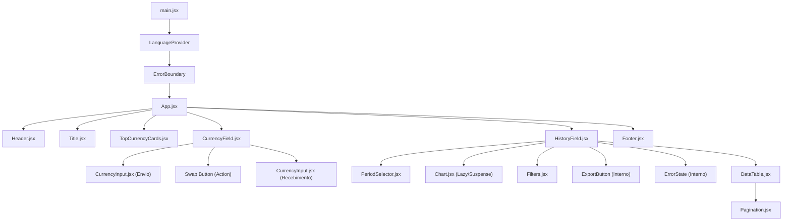

# 🧱 Arquitetura e Catálogo de Componentes — Hermes

Este documento descreve a estrutura de componentes React da aplicação **Hermes**, detalhando responsabilidades, arquivos-fonte, estratégia de estilização, propriedades recebidas (*props*), estados internos (*state*) e suas relações hierárquicas.

---

## 1. Visão Geral da Arquitetura

A aplicação é estruturada como uma Single Page Application (SPA) em **React 19** utilizando Vite. O gerenciamento de estado global de internacionalização é provido pelo `LanguageProvider`, enquanto a lógica de requisição assíncrona, resiliência e tratamento de dados é encapsulada em Custom Hooks (`useExchangeRate`, `useHistoricalData`, `useTopCurrencies`) e no serviço centralizado `api.js`.

### 1.1. Estratégia de Estilização
O projeto utiliza o **Tailwind CSS v4** integrado nativamente via `@tailwindcss/vite` e declarado no arquivo global [index.css](file:///c:/Users/GleissonBdf/Downloads/p1-currency-exchange-app/currency-exchange-app/src/index.css). As classes utilitárias são aplicadas diretamente nos elementos JSX com foco em responsividade (`sm:`, `md:`, `lg:`), flexbox, CSS grid e paleta de cores institucional verde-esmeralda/ardósia (`emerald`, `slate`, `gray`, `red`).

---

## 2. Mapa Hierárquico de Componentes

---

## 3. Catálogo Detalhado de Componentes

### 3.1. `App`
- **Responsabilidade:** Componente raiz da aplicação. Gerencia a busca inicial da lista de moedas da API Frankfurter (`/currencies`), banner de erro de conexão com retry manual, os estados globais das moedas selecionadas (`from` e `to`) e a disposição vertical dos blocos principais em contêiner centralizado e responsivo.
- **Arquivo JSX:** `src/App.jsx`
- **Props:** Nenhuma (componente raiz).
- **Estados Internos:**
  - `currencies` (`Object`): Dicionário com código e nome de todas as moedas suportadas (ex: `{ USD: "United States Dollar", BRL: "Brazilian Real", ... }`).
  - `currenciesError` (`String | null`): Mensagem de erro em caso de falha na busca inicial de moedas.
  - `currenciesRetry` (`Number`): Contador para disparar novas tentativas de consulta de moedas.
  - `from` (`String`): Moeda de origem selecionada (padrão: `"USD"`).
  - `to` (`String`): Moeda de destino selecionada (padrão: `"BRL"`).
- **Relação com outros componentes:** Renderiza [Header](file:///c:/Users/GleissonBdf/Downloads/p1-currency-exchange-app/currency-exchange-app/src/components/Header.jsx), [Title](file:///c:/Users/GleissonBdf/Downloads/p1-currency-exchange-app/currency-exchange-app/src/components/Title.jsx), [TopCurrencyCards](file:///c:/Users/GleissonBdf/Downloads/p1-currency-exchange-app/currency-exchange-app/src/components/TopCurrencyCards.jsx), [CurrencyField](file:///c:/Users/GleissonBdf/Downloads/p1-currency-exchange-app/currency-exchange-app/src/components/CurrencyField.jsx), [HistoryField](file:///c:/Users/GleissonBdf/Downloads/p1-currency-exchange-app/currency-exchange-app/src/components/HistoryField.jsx) e [Footer](file:///c:/Users/GleissonBdf/Downloads/p1-currency-exchange-app/currency-exchange-app/src/components/Footer.jsx).

---

### 3.2. `Header`
- **Responsabilidade:** Exibe a barra de navegação superior com o logotipo da marca Hermes, avatar institucional e os seletores de internacionalização (`PT`, `EN`, `ES`).
- **Arquivo JSX:** `src/components/Header.jsx`
- **Estilização:** Tailwind CSS (`flex`, `items-center`, `justify-between`, `p-4 sm:p-6 md:p-8`).
- **Props:** Nenhuma.
- **Estados Consumidos:** `language` e `setLanguage` do `useLanguage()`.
- **Relação com outros componentes:** Filho de `App`.

---

### 3.3. `Title`
- **Responsabilidade:** Seção de boas-vindas (*Hero Section*) com a tagline de clareza nas decisões, título principal da aplicação e subtítulo descritivo traduzido dinamicamente.
- **Arquivo JSX:** `src/components/Title.jsx`
- **Estilização:** Tailwind CSS (`text-3xl sm:text-4xl md:text-5xl lg:text-6xl font-extrabold`).
- **Props:** Nenhuma.
- **Estados Consumidos:** `t` (função de tradução) do `useLanguage()`.
- **Relação com outros componentes:** Filho de `App`.

---

### 3.4. `TopCurrencyCards`
- **Responsabilidade:** Exibe um grid com cards das 5 moedas mais negociadas do mundo (`USD`, `EUR`, `GBP`, `JPY`, `CNY`), tendo como referência a moeda de origem (`from`). Apresenta a cotação `1 from = X moeda`, selo de "Moeda base" na moeda atual e badge de variação percentual dos 2 últimos dias úteis com cores condicionais (verde para alta, vermelho para baixa). Mostra skeletons animados durante o carregamento.
- **Arquivo JSX:** `src/components/TopCurrencyCards.jsx`
- **Estilização:** Grid responsivo (`grid-cols-2 sm:grid-cols-3 lg:grid-cols-5`), com o último card ocupando 2 colunas no mobile para equilíbrio estético.
- **Props Recebidas:**
  - `from` (`String`): Moeda de referência base.
  - `currencies` (`Object`): Dicionário com os nomes das moedas.
- **Hooks Utilizados:** `useTopCurrencies(from)` e `useLanguage()`.
- **Relação com outros componentes:** Filho de `App`.

---

### 3.5. `CurrencyField`
- **Responsabilidade:** Card principal de conversão cambial. Controla a digitação do valor de envio (com normalização de vírgula para ponto e bloqueio de múltiplos separadores), calcula o valor convertido de destino instantaneamente em memória, executa a inversão de moedas (*swap*), consome `useExchangeRate` e exibe a cotação comercial oficial formatada com data de referência.
- **Arquivo JSX:** `src/components/CurrencyField.jsx`
- **Estilização:** Tailwind CSS (`bg-emerald-950 rounded-2xl mx-4 my-6 sm:mx-6 md:mx-8 shadow-xl`).
- **Props Recebidas:**
  - `currencies` (`Object`): Lista de moedas disponíveis.
  - `from` (`String`): Moeda de envio atual.
  - `to` (`String`): Moeda de recebimento atual.
  - `onFromChange` (`Function`): Callback disparado ao trocar a moeda de envio.
  - `onToChange` (`Function`): Callback disparado ao trocar a moeda de destino.
- **Estados Internos:**
  - `amount` (`String`): Quantidade digitada pelo usuário para conversão (padrão: `"1000"`).
  - `result` (`Number | null`): Valor calculado derivado (`amount * rate`).
- **Hooks Utilizados:** `useExchangeRate(from, to)` e `useLanguage()`.
- **Relação com outros componentes:** Renderiza duas instâncias de `CurrencyInput` e o botão de inversão de moedas (*Swap*).

---

### 3.6. `CurrencyInput`
- **Responsabilidade:** Bloco individual de input monetário contendo o rótulo da operação ("Você envia" ou "Você recebe"), o código da moeda, campo de valor com suporte a formatação localizada via `Intl.NumberFormat` e dropdown `<select>` acessível com código e nome por extenso.
- **Arquivo JSX:** `src/components/CurrencyInput.jsx`
- **Estilização:** Tailwind CSS (`bg-white rounded-2xl p-4 sm:p-6 md:p-8 w-full shadow-sm`).
- **Props Recebidas:**
  - `label` (`String`): Texto do rótulo superior.
  - `value` (`String`): Valor atual do input.
  - `onChange` (`Function`): Callback para atualização do valor digitado.
  - `currency` (`String`): Código da moeda selecionada (ex: `"USD"`).
  - `onCurrencyChange` (`Function`): Callback disparado ao escolher outra moeda no dropdown.
  - `currencies` (`Object`): Dicionário de moedas disponíveis.
  - `readOnly` (`Boolean`, opcional): Define se o campo é apenas leitura (usado no campo de destino).
- **Relação com outros componentes:** Filho de `CurrencyField`.

---

### 3.7. `HistoryField`
- **Responsabilidade:** Seção analítica e histórica. Gerencia o período temporal ativo, consome `useHistoricalData`, processa os dados de forma otimizada via `useMemo` (filtrando por data/cotação e calculando máxima, mínima e variação do período), orquestra o gráfico sob demanda (*lazy*), filtros, botão de exportação e a tabela paginada.
- **Arquivo JSX:** `src/components/HistoryField.jsx`
- **Estilização:** Tailwind CSS (`p-4 sm:p-6 md:p-8`).
- **Props Recebidas:**
  - `from` (`String`): Moeda base.
  - `to` (`String`): Moeda comparada.
- **Estados Internos:**
  - `period` (`String`): Período ativo selecionado (padrão: `"30D"`).
  - `filters` (`Object`): Critérios manuais de filtro (`{ startDate, endDate, minRate, maxRate }`).
  - `sortField` (`String`): Coluna de ordenação ativa (`"date"` ou `"rate"`).
  - `sortDir` (`String`): Direção da ordenação (`"asc"` ou `"desc"`).
- **Hooks Utilizados:** `useHistoricalData(from, to, period)`, `useLanguage()` e `useMemo`.
- **Subcomponentes Internos:**
  - `ExportButton`: Botão acessível para disparar o download do CSV.
  - `ErrorState`: Feedback visual em caso de falha com botão de *retry*.
- **Relação com outros componentes:** Renderiza `PeriodSelector`, `Chart` (em `Suspense`), `Filters`, `ExportButton`, `ErrorState` e `DataTable`.

---

### 3.8. `PeriodSelector`
- **Responsabilidade:** Barra de botões interativos para troca de intervalo temporal (`7D`, `15D`, `30D`, `3M`, `6M`, `1A`, `5A`, `10A`) com suporte a toque e rolagem horizontal suave em dispositivos móveis (`overflow-x-auto`).
- **Arquivo JSX:** `src/components/PeriodSelector.jsx`
- **Props Recebidas:**
  - `period` (`String`): Período atualmente ativo.
  - `onChange` (`Function`): Callback disparado ao clicar em um período.
- **Relação com outros componentes:** Filho de `HistoryField`.

---

### 3.9. `Chart`
- **Responsabilidade:** Gráfico de área interativo baseado na biblioteca **Recharts**, carregado sob demanda via `React.lazy` para preservar o tempo de carregamento inicial. Utiliza chave única no eixo X (`dataKey="date"`), garantindo acompanhamento fluido e ininterrupto do cursor (`activeDot`). O *tooltip* exibe a data completa e cotação com 4 casas decimais, enquanto os *ticks* do eixo X são formatados de maneira contextual e sem ambiguidades via `date-fns`.
- **Arquivo JSX:** `src/components/Chart.jsx`
- **Estilização:** Tailwind CSS e Recharts SVG Styling (`w-full h-64 sm:h-72 md:h-80`, gradiente linear esmeralda).
- **Props Recebidas:**
  - `data` (`Array`): Coleção de registros históricos ordenados cronologicamente.
  - `period` (`String`): Período ativo (para formatação inteligente das legendas).
- **Relação com outros componentes:** Filho de `HistoryField` (envolvido por `Suspense`).

---

### 3.10. `Filters`
- **Responsabilidade:** Formulário de filtros avançados para restringir os registros por intervalo de datas (início/fim) e limites de cotação (mínimo/máximo), com botão para limpar filtros e restaurar o período completo.
- **Arquivo JSX:** `src/components/Filters.jsx`
- **Props Recebidas:**
  - `filters` (`Object`): Estado dos filtros.
  - `onChange` (`Function`): Função para atualizar os filtros.
  - `onClear` (`Function`): Função para resetar os filtros.
- **Relação com outros componentes:** Filho de `HistoryField`.

---

### 3.11. `DataTable`
- **Responsabilidade:** Tabela de dados históricos com suporte a ordenação por clique nos cabeçalhos (com atributos de acessibilidade `aria-sort`), cálculo de variação em relação ao dia anterior útil real e paginação client-side com 10 linhas por página.
- **Arquivo JSX:** `src/components/DataTable.jsx`
- **Props Recebidas:**
  - `data` (`Array`): Coleção de dados históricos.
  - `onSort` (`Function`): Callback de ordenação por cabeçalho.
  - `sortField` (`String`): Campo de ordenação ativo.
  - `sortDir` (`String`): Direção (`"asc"` ou `"desc"`).
  - `pageSize` (`Number`, opcional, padrão: `10`): Quantidade de linhas por página.
- **Relação com outros componentes:** Renderiza o componente `Pagination` no rodapé da tabela.

---

### 3.12. `Pagination`
- **Responsabilidade:** Controles de navegação de página da tabela com botões "Anterior" e "Próxima", limites de desabilitação e texto dinâmico traduzido (`Página X de Y · início–fim de total`). Oculta-se automaticamente quando há apenas 1 página.
- **Arquivo JSX:** `src/components/Pagination.jsx`
- **Props Recebidas:**
  - `page` (`Number`): Página ativa atual.
  - `pageSize` (`Number`): Quantidade de itens por página.
  - `totalItems` (`Number`): Total de registros no conjunto filtrado.
  - `onPageChange` (`Function`): Callback chamado ao avançar ou retroceder a página.
- **Relação com outros componentes:** Filho de `DataTable`.

---

### 3.13. `ErrorBoundary`
- **Responsabilidade:** Captura falhas de renderização inesperadas em qualquer ponto da árvore React através dos métodos de ciclo de vida de classe (`getDerivedStateFromError`, `componentDidCatch`). Apresenta uma tela de fallback segura e traduzida com botão para recarregar a página, impedindo a tela branca.
- **Arquivo JSX:** `src/components/ErrorBoundary.jsx`
- **Props Recebidas:**
  - `children` (`ReactNode`): Elementos filhos protegidos.
  - `fallback` (`ReactNode`, opcional): Interface personalizada de erro (possui fallback padrão integrado).
- **Relação com outros componentes:** Envolve `App` em `main.jsx`.

---

### 3.14. `Footer`
- **Responsabilidade:** Rodapé da aplicação com marca Hermes, avatar institucional e copyright com ano e texto traduzido.
- **Arquivo JSX:** `src/components/Footer.jsx`
- **Props:** Nenhuma.
- **Relação com outros componentes:** Filho de `App`.

---

## 4. Contexto Global de Internacionalização (`LanguageProvider`)

O sistema de internacionalização é estruturado em arquivos especializados para garantir compatibilidade com o Fast Refresh do Vite:
* **`src/context/languageContext.js`:** Criação do `LanguageContext` via `createContext(null)`.
* **`src/context/translations.js`:** Dicionário completo de cópias nos idiomas `PT`, `EN` e `ES`.
* **`src/context/LanguageProvider.jsx`:** Provedor do estado do idioma com função de tradução memorizada `t(key)`.
* **`src/context/useLanguage.js`:** Custom Hook que expõe `{ language, setLanguage, t }` a qualquer componente consumidor.
