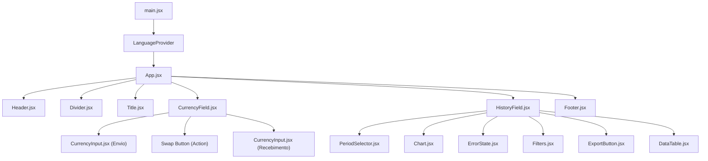

# 🧱 Arquitetura e Catálogo de Componentes — Hermes

Este documento descreve a estrutura de componentes React da aplicação **Hermes**, detalhando responsabilidades, arquivos-fonte, estratégia de estilização, propriedades recebidas (*props*), estados internos (*state*) e suas relações hierárquicas.

---

## 1. Visão Geral da Arquitetura

A aplicação é estruturada como uma Single Page Application (SPA) em **React 19** utilizando Vite. O gerenciamento de estado global de internacionalização é provido pelo `LanguageContext`, enquanto a lógica de requisição assíncrona e tratamento de dados históricos é encapsulada em Custom Hooks (`useExchangeRate`, `useHistoricalData`).

### 1.1. Estratégia de Estilização
O projeto utiliza o **Tailwind CSS v4** integrado nativamente via `@tailwindcss/vite` e declarado em [index.css](file:///c:/Users/GleissonBdf/Downloads/p1-currency-exchange-app/currency-exchange-app/src/index.css) e [App.css](file:///c:/Users/GleissonBdf/Downloads/p1-currency-exchange-app/currency-exchange-app/src/App.css). As classes utilitárias são aplicadas diretamente nos elementos JSX com foco em responsividade (`sm:`, `md:`, `lg:`), flexbox, grid e paleta de cores temática verde-esmeralda/ardósia (`emerald`, `slate`, `gray`).

---

## 2. Mapa Hierárquico de Componentes

---

## 3. Catálogo Detalhado de Componentes

### 3.1. `App`
- **Responsabilidade:** Componente raiz da aplicação. Gerencia a busca inicial da lista de moedas da API Frankfurter, os estados globais das moedas selecionadas (`from` e `to`) e a disposição vertical dos blocos principais em um contêiner centralizado e responsivo.
- **Arquivo JSX:** `src/App.jsx`
- **Arquivo de Estilo:** `src/App.css` (Tailwind CSS v4)
- **Props:** Nenhuma (componente raiz).
- **Estados Internos:**
  - `currencies` (`Object`): Dicionário com código e nome de todas as moedas suportadas (ex: `{ USD: "United States Dollar", BRL: "Brazilian Real", ... }`).
  - `from` (`String`): Moeda de origem selecionada (padrão: `"USD"`).
  - `to` (`String`): Moeda de destino selecionada (padrão: `"BRL"`).
- **Relação com outros componentes:** Renderiza [Header](file:///c:/Users/GleissonBdf/Downloads/p1-currency-exchange-app/currency-exchange-app/src/components/Header.jsx), [Divider](file:///c:/Users/GleissonBdf/Downloads/p1-currency-exchange-app/currency-exchange-app/src/components/Divider.jsx), [Title](file:///c:/Users/GleissonBdf/Downloads/p1-currency-exchange-app/currency-exchange-app/src/components/Title.jsx), [CurrencyField](file:///c:/Users/GleissonBdf/Downloads/p1-currency-exchange-app/currency-exchange-app/src/components/CurrencyField.jsx), [HistoryField](file:///c:/Users/GleissonBdf/Downloads/p1-currency-exchange-app/currency-exchange-app/src/components/HistoryField.jsx) e [Footer](file:///c:/Users/GleissonBdf/Downloads/p1-currency-exchange-app/currency-exchange-app/src/components/Footer.jsx).

---

### 3.2. `Header`
- **Responsabilidade:** Exibe a barra de navegação superior com o logotipo da marca Hermes, avatar institucional e os seletores de internacionalização (`PT`, `EN`, `ES`).
- **Arquivo JSX:** `src/components/Header.jsx`
- **Estilização:** Tailwind CSS (`flex`, `items-center`, `justify-between`, `p-4 sm:p-6 md:p-8`).
- **Props:** Nenhuma.
- **Estados Consumidos:** `language` e `setLanguage` do `useLanguage()`.
- **Relação com outros componentes:** Filho de `App`.

---

### 3.3. `Title`
- **Responsabilidade:** Seção de boas-vindas (*Hero Section*) com a tagline de clareza nas decisões, título principal da aplicação e subtítulo descritivo traduzido dinamicamente.
- **Arquivo JSX:** `src/components/Title.jsx`
- **Estilização:** Tailwind CSS (`text-3xl sm:text-4xl md:text-5xl lg:text-6xl font-extrabold`).
- **Props:** Nenhuma.
- **Estados Consumidos:** `t` (função de tradução) do `useLanguage()`.
- **Relação com outros componentes:** Filho de `App`.

---

### 3.4. `Divider`
- **Responsabilidade:** Renderização de uma linha separadora horizontal sutil para demarcação visual com margens responsivas.
- **Arquivo JSX:** `src/components/Divider.jsx`
- **Estilização:** Tailwind CSS (`border-0 bg-slate-200 h-[0.5px] mx-4 sm:mx-6 md:mx-8`).
- **Props:** Nenhuma.
- **Estados Internos:** Sem estado (componente puramente funcional/presentacional).
- **Relação com outros componentes:** Filho de `App`.

---

### 3.5. `CurrencyField`
- **Responsabilidade:** Card principal de conversão cambial. Controla a digitação do valor de envio, calcula o valor convertido de destino, executa a troca de moedas (*swap*), consome o hook `useExchangeRate` e exibe a cotação comercial oficial da data.
- **Arquivo JSX:** `src/components/CurrencyField.jsx`
- **Estilização:** Tailwind CSS (`bg-emerald-950 rounded-2xl mx-4 my-6 sm:mx-6 md:mx-8 shadow-xl`).
- **Props Recebidas:**
  - `currencies` (`Object`): Lista de moedas disponíveis.
  - `from` (`String`): Moeda de envio atual.
  - `to` (`String`): Moeda de recebimento atual.
  - `onFromChange` (`Function`): Callback disparado ao trocar a moeda de envio.
  - `onToChange` (`Function`): Callback disparado ao trocar a moeda de destino.
- **Estados Internos:**
  - `amount` (`String`): Quantidade digitada pelo usuário para conversão (padrão: `"1000"`).
  - `result` (`Number | null`): Valor calculado derivado (`amount * rate`).
- **Hooks Utilizados:** `useExchangeRate(from, to)` e `useLanguage()`.
- **Relação com outros componentes:** Renderiza duas instâncias de `CurrencyInput` e o botão de inversão de moedas.

---

### 3.6. `CurrencyInput`
- **Responsabilidade:** Bloco individual de input monetário contendo o rótulo da operação ("Você envia" ou "Você recebe"), o código da moeda, campo de valor com suporte a formatação localizada e dropdown de seleção de moeda.
- **Arquivo JSX:** `src/components/CurrencyInput.jsx`
- **Estilização:** Tailwind CSS (`bg-white rounded-2xl p-4 sm:p-6 md:p-8 w-full shadow-sm`).
- **Props Recebidas:**
  - `label` (`String`): Texto do rótulo superior.
  - `value` (`String`): Valor atual do input.
  - `onChange` (`Function`): Callback para atualização do valor digitado.
  - `currency` (`String`): Código da moeda selecionada (ex: `"USD"`).
  - `onCurrencyChange` (`Function`): Callback disparado ao escolher outra moeda no dropdown.
  - `currencies` (`Object`): Dicionário de moedas disponíveis.
  - `readOnly` (`Boolean`, opcional): Define se o campo é apenas leitura (usado no campo de destino).
- **Estados Internos:** Nenhum (controlado pelo pai `CurrencyField`).
- **Relação com outros componentes:** Filho de `CurrencyField`.

---

### 3.7. `HistoryField`
- **Responsabilidade:** Seção analítica e histórica. Gerencia o período temporal ativo, consome `useHistoricalData`, aplica ordenação e filtros (data e cotação), calcula estatísticas de mercado (*Máxima*, *Mínima* e *Variação %*) e orquestra o gráfico, filtros, botão de exportação e tabela.
- **Arquivo JSX:** `src/components/HistoryField.jsx`
- **Estilização:** Tailwind CSS (`p-4 sm:p-6 md:p-8`).
- **Props Recebidas:**
  - `from` (`String`): Moeda base.
  - `to` (`String`): Moeda comparada.
- **Estados Internos:**
  - `period` (`String`): Período ativo selecionado (padrão: `"30D"`).
  - `filters` (`Object`): Critérios manuais de filtro (`{ startDate, endDate, minRate, maxRate }`).
  - `sortField` (`String`): Coluna de ordenação ativa (`"date"` ou `"rate"`).
  - `sortDir` (`String`): Direção da ordenação (`"asc"` ou `"desc"`).
- **Hooks Utilizados:** `useHistoricalData(from, to, period)`, `useLanguage()` e `useMemo` para computar `filteredData`.
- **Relação com outros componentes:** Renderiza `PeriodSelector`, `Chart`, `ErrorState`, `Filters`, `ExportButton` e `DataTable`.

---

### 3.8. `PeriodSelector`
- **Responsabilidade:** Barra de botões interativos para troca de intervalo temporal (`7D`, `15D`, `30D`, `3M`, `6M`, `1A`, `5A`, `10A`) com suporte a toque e rolagem horizontal em dispositivos móveis.
- **Arquivo JSX:** `src/components/PeriodSelector.jsx`
- **Estilização:** Tailwind CSS (`flex max-w-full overflow-x-auto bg-slate-200 rounded-xl sm:rounded-2xl`).
- **Props Recebidas:**
  - `period` (`String`): Período atualmente ativo.
  - `onChange` (`Function`): Callback disparado ao clicar em um período.
- **Relação com outros componentes:** Filho de `HistoryField`.

---

### 3.9. `Chart`
- **Responsabilidade:** Renderização do gráfico de área interativo baseado na biblioteca **Recharts**, formatando eixos temporais com `date-fns` conforme o idioma do usuário e exibindo *tooltip* personalizado com a cotação exata com 4 casas decimais.
- **Arquivo JSX:** `src/components/Chart.jsx`
- **Estilização:** Tailwind CSS e Recharts SVG Styling (`w-full h-64 sm:h-72 md:h-80`, gradiente linear verde-esmeralda).
- **Props Recebidas:**
  - `data` (`Array`): Coleção de registros históricos (`[{ date, rate, from, to }]`).
  - `period` (`String`): Período ativo (para ajuste do formato de data nos eixos).
- **Relação com outros componentes:** Filho de `HistoryField`.

---

### 3.10. `Filters`
- **Responsabilidade:** Formulário de filtros avançados para restringir os registros por data de início/fim e limites mínimo e máximo de cotação, além de ação para resetar os filtros.
- **Arquivo JSX:** `src/components/Filters.jsx`
- **Estilização:** Tailwind CSS (`flex flex-wrap gap-2.5 sm:gap-3 items-center`).
- **Props Recebidas:**
  - `filters` (`Object`): Estado dos filtros.
  - `onChange` (`Function`): Função para atualizar os filtros.
  - `onClear` (`Function`): Função para limpar os filtros.
- **Relação com outros componentes:** Filho de `HistoryField`.

---

### 3.11. `DataTable`
- **Responsabilidade:** Tabela de dados diários históricos com suporte a ordenação por cabeçalho clicável, cálculo em tempo real de variação em relação ao dia anterior com destaque de cor (verde para alta, vermelho para baixa) e visualização responsiva com scroll horizontal.
- **Arquivo JSX:** `src/components/DataTable.jsx`
- **Estilização:** Tailwind CSS (`w-full min-w-[540px] border-collapse`).
- **Props Recebidas:**
  - `data` (`Array`): Dados históricos filtrados e ordenados.
  - `onSort` (`Function`): Callback disparado ao clicar nos cabeçalhos ordenáveis.
  - `sortField` (`String`): Nome do campo de ordenação ativo.
  - `sortDir` (`String`): Sentido da ordenação (`"asc"` ou `"desc"`).
- **Relação com outros componentes:** Filho de `HistoryField`.

---

### 3.12. `ExportButton`
- **Responsabilidade:** Botão de ação rápida que aciona a geração e download do arquivo CSV contendo os dados históricos atualmente filtrados, com ícone SVG `ArrowDownToLine`.
- **Arquivo JSX:** `src/components/ExportButton.jsx`
- **Estilização:** Tailwind CSS (`bg-emerald-950 text-white px-4 py-2 rounded-xl text-xs sm:text-sm`).
- **Props Recebidas:**
  - `onClick` (`Function`): Ação disparada ao clicar.
  - `disabled` (`Boolean`): Desabilita o botão caso a lista de dados esteja vazia.
- **Relação com outros componentes:** Filho de `HistoryField`.

---

### 3.13. `ErrorState`
- **Responsabilidade:** Apresentação amigável de estado de falha quando ocorre erro de rede ou resposta não autorizada da API, com ícone de alerta e botão interativo para tentar recarregar os dados.
- **Arquivo JSX:** `src/components/ErrorState.jsx`
- **Estilização:** Tailwind CSS (`bg-white rounded-2xl p-8 sm:p-12 flex flex-col items-center justify-center`).
- **Props Recebidas:**
  - `onRetry` (`Function`): Callback de repetição da consulta.
- **Relação com outros componentes:** Filho de `HistoryField`.

---

### 3.14. `Footer`
- **Responsabilidade:** Rodapé da aplicação com assinatura visual, logotipo Hermes e mensagem de direitos autorais traduzida.
- **Arquivo JSX:** `src/components/Footer.jsx`
- **Estilização:** Tailwind CSS (`flex flex-col sm:flex-row p-4 sm:p-6 md:p-8 items-center justify-between border-t`).
- **Props:** Nenhuma.
- **Relação com outros componentes:** Filho de `App`.

---

## 4. Contexto Global: `LanguageContext`
- **Arquivo:** `src/context/LanguageContext.jsx`
- **Responsabilidade:** Fornece o estado do idioma selecionado (`PT`, `EN`, `ES`), função para alteração (`setLanguage`) e função de recuperação de texto traduzido `t(chave)` para todos os componentes consumidores via hook customizado `useLanguage()`.
